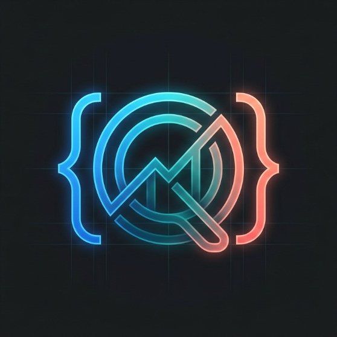

<div align="center">



# DeskLens

**Ultra-fast, stealthy desktop Vision AI copilot for instant visual reasoning, MCQ solving, and screen intelligence.**

[-blue.svg?style=flat-square&logo=windows)](https://www.microsoft.com/windows)
[](https://www.python.org/)
[](https://build.nvidia.com)
[](#-testing)
[](LICENSE)

</div>

---

## 📖 Overview

**DeskLens** is a lightweight, zero-latency desktop vision assistant designed for developers, researchers, and students. It captures any cropped area of your screen (using Windows Snipping Tool) and delivers concise, mathematically verified answers and reasoning through a cascading chain of state-of-the-art multimodal AI models.

Built with **stealth-first architecture**, DeskLens runs 100% invisibly in the background without stealing window focus, displaying intrusive taskbar icons, or showing alert dialogs.

---

## ⚡ Key Highlights

### 👻 1. Ghost Mode & Stealth Operation
* **Zero-Interruption Background Workflow:** Pressing `Ctrl + Shift + S` immediately analyzes your clipboard snip in the background without ever opening a window or interrupting your typing.
* **Peek on Demand (`Ctrl + ~`):** Press `Ctrl + ~` whenever you want to inspect the answer, and press it again (or `Esc`) to instantly vanish it.
* **Invisible Startup:** Starts directly in the background (`START_MINIMIZED=true`, `AUTO_SHOW_POPUP=false`) with no system tray icon (`SHOW_TRAY_ICON=false`).
* **Silent Error Handling:** Catches shortcut conflicts and connection blips silently without generating desktop warning boxes.

### 🧠 2. Resilient Multi-Cloud Vision AI Chain
DeskLens incorporates an intelligent 4-tier cascading failover system with automatic circuit breaking:

| Priority | Provider | Model | Highlights |
|:---:|:---|:---|:---|
| **Main** | **NVIDIA NIM** | `meta/llama-3.2-90b-vision-instruct` | Flagship 90B reasoning on DGX TensorRT-LLM cloud; 1,000 free inference credits. |
| **1st Backup** | **OVHcloud Kepler** | `Qwen2.5-VL-72B-Instruct` | 100% Free & Keyless European cloud; unmatched OCR, table, and small math formula accuracy. Unblocked on campus/lab firewalls. |
| **2nd Backup** | **Groq Cloud** | `llama-3.2-11b-vision-preview` | Ultra-fast LPU inference fallback. |
| **3rd Backup** | **OpenRouter** | `nvidia/nemotron-3.5-super-vl:free` | Universal router fallback (`openrouter/free`). |

* **Circuit Breaker Engine:** If any provider encounters a rate limit (HTTP 429), timeout, or server downtime, it is placed on a cooldown period while healthy providers are routed immediately without slowing down the user.
* **Smart Offline Detection:** If Wi-Fi or Ethernet drops, the circuit breaker resets automatically so that the moment your network reconnects, your primary provider is queried immediately.

### 🛡️ 3. Anti-Forensics & Reverse-Engineering Defenses
DeskLens is hardened against static inspection, memory dumps, and reverse engineering:
* **Dynamic Rolling XOR Cipher (`system.dat`):** Sensitive configuration variables and API tokens are dynamically encrypted inside the binary using a multi-round rolling feedback key derived at runtime from SHA-256 byte fragments. No static key strings exist in code.
* **String Obfuscation:** API endpoints, prompt templates, and MCQ keywords are bitwise-masked. Running `strings.exe` or viewing the binary in a hex editor reveals **zero** plaintext URLs or API keys.
* **Level-2 Bytecode Optimization (`optimize=2`):** Python bytecode is stripped of all docstrings, assertions, and debug symbols.
* **Anti-Debugging Guard:** Native Windows API checks (`IsDebuggerPresent` and `CheckRemoteDebuggerPresent`) silently terminate the process if a debugger is attached.
* **Camouflaged Mutex:** Operates under a standard Windows system host broker mutex (`Local\WinBrokerHostMutex_92A1`).

### 🪟 4. Compact Frosted Glass UI
* Minimalist frameless floating widget with dark translucent slate styling.
* Real-time token streaming (`stream=True`) rendered into Markdown with clean typography.
* On-the-fly opacity adjustment: `Ctrl + [` (more translucent), `Ctrl + ]` (more opaque), or `Ctrl + Mouse Wheel`.
* Click and drag anywhere on the window to reposition.

---

## ⌨️ Global Shortcuts

| Shortcut | Action | Description |
|:---|:---|:---|
| **`Win + Shift + S`** | **Capture Area** | Windows native Snipping Tool (snip any question, formula, or code). |
| **`Ctrl + Shift + S`** | **Silent Analyze** | Ingests clipboard image and processes via AI in background without popup. |
| **`Ctrl + ~`** | **Toggle Window** | Peeks at the floating answer window on demand; press again to hide. |
| **`Ctrl + [` / `Ctrl + ]`** | **Adjust Opacity** | Adjusts window transparency live (`20%` to `100%`). |
| **`Ctrl + Mouse Wheel`** | **Smooth Opacity** | Smooth real-time transparency scrolling. |
| **`Esc`** | **Dismiss** | Closes the floating popup widget. |
| **`Ctrl + Shift + Q`** | **Emergency Exit** | Instantly unregisters hotkeys and terminates the background process. |

> **Note:** The `~` (tilde) key is located directly below `Esc` and above `Tab` on standard keyboards.

---

## 🚀 Quick Start

### Option A: Portable Standalone Executable (No Python Required)
DeskLens is distributed as a single-file portable Windows executable (~40 MB) that works out of the box on Windows 10 and 11 without administrative privileges:

1. Download or locate `dist/DeskLens.exe`.
2. Double-click `DeskLens.exe` to run. It will start silently in the background.
3. Use `Win + Shift + S` to snip &rarr; `Ctrl + Shift + S` to analyze &rarr; `Ctrl + ~` to view the answer!

*(Optional: To customize settings or supply external API keys, place a `.env` file in the same directory as `DeskLens.exe`).*

---

### Option B: Running from Source

#### Prerequisites
* Windows 10 or 11 (64-bit)
* Python 3.11 or 3.12

#### Setup Steps
```powershell
# 1. Clone the repository
git clone https://github.com/Krishan418/EasyAnswer.git
cd EasyAnswer

# 2. Create virtual environment
python -m venv .venv
.\.venv\Scripts\activate

# 3. Install dependencies
pip install -r screenshot_ai/requirements.txt

# 4. Configure environment
copy .env.example .env
# Edit .env with your desired API keys

# 5. Run DeskLens
python main.py
```

---

## 🔨 Building the Executable

To compile the standalone hardened executable yourself:

```powershell
# Ensure virtual environment is activated
.\.venv\Scripts\activate

# Build using PyInstaller with UPX compression & Level-2 optimization
.\.venv\Scripts\pyinstaller.exe EasyAnswer.spec --noconfirm
```

The resulting standalone binary will be generated at `dist/DeskLens.exe`.

---

## ⚙️ Configuration Reference (`.env`)

| Variable | Default | Description |
|:---|:---|:---|
| `PRIMARY_PROVIDER` | `nvidia` | Primary AI provider (`nvidia`, `ovh`, `groq`, `openrouter`). |
| `NVIDIA_API_KEY` | *(Configured)* | Free NVIDIA NIM API key (`nvapi-...`) from [build.nvidia.com](https://build.nvidia.com). |
| `NVIDIA_MODEL` | `meta/llama-3.2-90b-vision-instruct` | Flagship 90B multimodal reasoning model. |
| `ENABLE_OVH` | `true` | Keyless, unblocked Qwen2.5-VL-72B safety net via European cloud. |
| `GROQ_API_KEY` | *(Optional)* | Groq Cloud API key for ultra-fast LPU backup. |
| `OPENROUTER_API_KEY`| *(Optional)* | OpenRouter key for last-tier fallback. |
| `AUTO_SHOW_POPUP` | `false` | When `false`, answers stream in the background until toggled with `Ctrl + ~`. |
| `START_MINIMIZED` | `true` | When `true`, starts completely invisible on application launch. |
| `SHOW_TRAY_ICON` | `false` | When `false`, completely hides system tray icon. |
| `ENABLE_NOTIFICATIONS`| `false` | Disables Windows toast notifications for maximum stealth. |
| `HTTP_CONNECT_TIMEOUT`| `3.5` | Connection timeout in seconds. |
| `HTTP_READ_TIMEOUT` | `20.0` | Read timeout in seconds (tuned for 90B model inference). |
| `POPUP_WIDTH` | `260` | Popup width in pixels. |
| `POPUP_HEIGHT` | `85` | Popup height in pixels. |
| `POPUP_OPACITY` | `0.70` | Default window opacity (`0.20` to `1.00`). |

---

## 🧪 Testing

DeskLens includes an automated test suite verifying failover resilience, circuit breaking, ghost mode lifecycle, cipher reversibility, and format validation:

```powershell
.\.venv\Scripts\python.exe -m unittest discover tests -v
```

```text
Ran 37 tests in 0.355s
OK
```

---

## ⚖️ License & Disclaimer

This project is licensed under the **MIT License**. Developed for productivity, visual assistance, and academic research. Please adhere to your institution's acceptable use policies regarding AI assistance.
